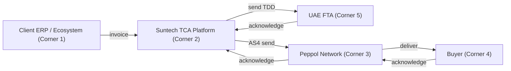
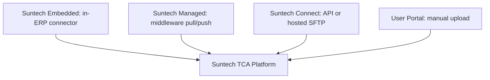
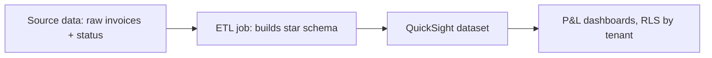
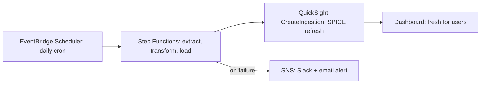

# SunTech Business Solutions — Platform & Project Overview

SunTech Business Solutions DMCC is an accredited Access Service Provider (ASP) for UAE e-invoicing. Clients don't deal with the Federal Tax Authority (FTA) directly — they route invoices through SunTech, which automates compliance using AI. The e-invoicing brand name is **TCA (Tax Compliance Agent)**, publicly marketed as **TaxComplianceAgent**.

## The 5-Corner Model

UAE e-invoicing runs on a Peppol-based "decentralized" model (DCTCE), an extension of the standard 4-corner Peppol model with a 5th corner added for tax reporting:

- **Corner 1** — Supplier (the client)
- **Corner 2** — Supplier's ASP — **this is SunTech**
- **Corner 3** — Buyer's ASP — the Peppol Network, AS4 secure exchange
- **Corner 4** — Buyer (Receiver), inbox/AP module
- **Corner 5** — UAE FTA (Tax Authority) — receives the Tax Data Document (TDD)

The **Suntech Tax Compliance Agent Platform** sits at the center: sends the TDD to the FTA (Corner 5) and receives acknowledgement, and separately sends the invoice through the Peppol Network (Corner 3) to the Buyer (Corner 4), with acknowledgements at each hop.

Scope is bidirectional: **outbound (AR / sales / export)** and **inbound (AP / purchase / import)** — SunTech operates as both the sending and receiving corner.

## Gap Analyzer Agent

A **RAG-based agent** that runs before an invoice enters the TCA Platform: detects missing/incomplete fields (vs. the PINT-AE schema), retrieves the company's known master data (TRN, address, trade license) from a source of truth — never generates it — auto-fills the gaps, then passes the invoice on. It also has a **public-facing version**: a free, self-serve "Gap Report" used as a lead-generation/readiness-check tool on the company's website, separate from the runtime per-invoice version.

## Integration Methods (4 tiers)

All four converge on the same TCA Platform backbone — they only differ in how data gets in.

**1. Suntech Embedded** — `TCA In-ERP Connector`, built by Suntech, lives inside the client's ERP (SAP, Oracle, Dynamics, NetSuite). 16–20 weeks, quote-based pricing. 6-phase delivery methodology: Discovery & Gap Analysis (wk1–2) → Solution Design & PINT-AE Mapping (wk3–5) → Connector Build (wk6–10) → Integration (wk8–12) → Testing/SIT+UAT across 16 use-cases, AR & AP (wk13–16) → Go-Live + EmaraTax registration + hyper-care (wk17–20).

**2. Suntech Managed** — Client data lands in a client-hosted SFTP folder, staging table, or S3 bucket (canonical format); Suntech Middleware pulls/pushes (CRON, 5 min), validates & transforms, retries with DLQ (3 attempts, exponential backoff, 30-day retention), writes status back. 2–4 weeks. 5,000 AED one-time + 500 AED/year.

**3. Suntech Connect** (self-serve, included in platform license) — Method A: Self-Serve REST API + OAuth 2.0, iPaaS-friendly, ~2–6 weeks. Method B: Hosted SFTP (shared multi-tenant or 250 AED/year dedicated). Platform fee 2,000 AED/year + per-invoice; optional paid integration support after first free session.

**4. User Portal** — Same-day, manual/bulk upload (CSV/XML/Excel/JSON/PINT-AE XML). Free aside from platform fee + per-invoice.

## Receive Channels (inbound, independent of send method)

User Portal (default) · ERP push (Embedded only) · Webhook · SFTP file drop · Email + portal link. Each legal entity picks its own.

## Cross-Cutting Technical Contracts

**Auth** — Embedded: ERP service account + API token. Connect API: OAuth 2.0 Client Credentials / API key. SFTP: SSH key + IP allowlist. Managed DB: read-only user + TLS. Managed S3: scoped IAM role. Portal: Cognito + mandatory admin MFA.
**Schema** — One published canonical JSON (→ PINT-AE) or PINT-AE XML directly; canonical SQL for staging. No per-client custom schemas.
**Idempotency** — `client_invoice_id`, unique per tenant; resend = safe no-op.
**Status feedback** — API: webhook + `GET /invoices/{id}/status`. SFTP: status file. Managed DB: status columns. All: optional email-on-failure.
**Multi-tenant** — Each legal entity = own tenant; groups hold multiple tenants with cross-tenant rollup.
**Rate limits** — API 100 RPS/tenant (burst 200); SFTP/staging/S3 pull every 5 min; portal bulk 10,000 rows/file.
**Retry/error** — 3 retries, exponential backoff; DLQ 30-day retention.
**Data residency** — AWS `me-central-1` (UAE). KMS at rest, TLS 1.2+ in transit, every channel.

## SFTP Channel Detail

Dedicated endpoint per tenant (Suntech-hosted push or client-hosted pull). Folders: `/outbound → /processing → /success or /error`. Three validation layers: structural → PINT-AE business rules → Peppol/participant checks. Per-file response with status, error codes, Peppol message ID. SFTP is batch/near-real-time, not synchronous; no PDF/OCR on this channel.

## Out of Scope (current wave)

Per-client custom schemas/templates, synchronous receive, pre-built iPaaS connectors, email-drop as a send channel, event-bus channels.

## Common Client Prerequisites

Valid TRN, signed MSA + DPA, named business + technical contact, clean master data, items mapped to tax categories, 5–10 sample invoices for validation, Peppol Participant ID registration, data residency acknowledgement.

## Responsibility Split

**Suntech always owns**: ASP accreditation, Peppol connectivity, PINT-AE compliance, SLA, encryption, UAE data residency, security monitoring, schema versioning.
**Client always owns**: tax compliance, master data accuracy, invoice content, own access management/infra.
**Joint**: UAT, go-live readiness, ambiguous-cause incident triage.

## Company Roadmap

MCP server for sending invoices from LLM tools; marketplace apps; PDF/OCR capture for non-Peppol suppliers.

## Pricing Snapshot

| Tier | Build | Ongoing | Timeline |
|---|---|---|---|
| Embedded | Quote-based | Quote-based | 16–20 weeks |
| Managed | 5,000 AED | 500 AED/yr | 2–4 weeks |
| Connect | Free | 2,000 AED/yr + per-invoice | 2–6 weeks |
| User Portal | Free | 2,000 AED/yr + per-invoice | Same day |

## Verified Public Facts (external research, June 2026)

Company is real and confirmed: pre-approved ASP on the UAE MoF registry, full Peppol AP/SMP certification, platform built by an ex-FAANG engineering team in Dubai on AWS. Co-founder/exec director: Tushar Gupta. Kanishka Garg is a real product/team representative (matches internal doc authorship). GTM is engineering/product-led (self-serve Gap Report, "talk to the team that built it" positioning) rather than classic BDR sales. The contact page has a separate "Group Tax Director" track for multi-entity/group clients, confirming the multi-tenant group structure is a deliberate sales segment. Public mentions cite a **~January 2027 deadline for VAT-registered businesses above AED 50M annual revenue** (all B2B/B2G) — treat exact thresholds as needing internal confirmation, since public coverage varies slightly across outlets.

---

# Current Project: P&L Invoice Analytics Dashboard

## Status & Scope

Standalone project — **not yet integrated into the TCA platform or client-facing Web Portal**. Pulls from a **read-only replica** of TCA's data store; never touches the primary production database. Audience is internal Suntech P&L leads, not clients. Tool decision is **locked in: Amazon QuickSight** (AWS-native; Power BI was considered and dropped).

Example user stories driving this: *"As a P&L lead for e-invoicing at Suntech, I want to know how many invoices were processed through my ASP"* and *"...for the customers of PwC."*

## Project Roadmap

Sequential phases for this dashboard build, distinct from the company-level roadmap above:

```mermaid
flowchart LR
    P0["Phase 0: Confirm scope & open questions"] --> P1["Phase 1: Data model + ETL"]
    P1 --> P2["Phase 2: QuickSight setup + RLS"]
    P2 --> P3["Phase 3: Build dashboard pages"]
    P3 --> P4["Phase 4: Automation + security hardening"]
    P4 --> P5["Phase 5: Validate + roll out to P&L leads"]
    P5 --> P6["Phase 6 (later): Feature backlog"]
    P6 --> P7["Phase 7 (future, optional): Portal/TCA integration"]
```

**Phase 0** — Resolve the open questions below before building anything on top of an assumption.
**Phase 1** — Design and build the star schema; stand up the read-only reporting replica; write the ETL transform.
**Phase 2** — QuickSight account/home region setup (UAE/Dubai), data source + dataset, dataset-level RLS rules, calculated fields.
**Phase 3** — Build pages in order: Executive overview → Tenant explorer → Operational health → Commercial (only if billing data is confirmed accessible).
**Phase 4** — Wire up the EventBridge/Step Functions refresh pipeline, SNS alerting, least-privilege IAM, malware scanning on upload paths, access logging.
**Phase 5** — Reconcile dashboard totals against raw source counts, get sign-off, invite P&L leads as QuickSight users.
**Phase 6** — Scope and prioritize items from the feature backlog (not yet approved, treat as candidates).
**Phase 7** — Only if/when client-portal integration is actually approved: build the embed-auth service and embed into the Web Portal.

## Open Questions (confirm with stakeholders, don't assume)

- Exact definition of "processed" — which status is the headline number (submitted vs. transmitted vs. FTA-acknowledged)?
- "Customers of X" — X's own buyers (most likely reading), or companies referred to Suntech by X?
- Counts only, or invoice value (AED) too, given this is a P&L view?
- Refresh cadence required (daily is the current default assumption)?

## Data Model (star schema)

`fact_invoice` (grain = one row per invoice): client_invoice_id, tenant_id, direction (AR/AP), channel, status, buyer_id, value, currency, submitted/transmitted/acknowledged timestamps, error_code.
Dimensions: `dim_tenant` (include a **parent/group rollup level** — multi-entity clients are a real segment), `dim_buyer`, `dim_date`, `dim_channel`.

## Dashboard Pages

**Executive overview** (landing page) — KPI cards (invoices processed, period change, total value, avg. time-to-acknowledge), trend chart by status, tier breakdown, status breakdown, top tenants by volume.
**Tenant explorer** — tenant selector drives everything below it: that tenant's volume, AR/AP split, trend, tier, and a breakdown of *their* buyers (this is what actually answers the "customers of PwC" question).
**Operational health** — rejection rate trend, error code breakdown, time-to-acknowledge distribution, channel-level error rates.
**Commercial/revenue** (conditional on billing data being accessible — confirm, don't assume) — revenue by tier, tenant growth, churn/inactivity flag.

All pages share one global filter bar: date range, tenant, AR/AP.

## Architecture & Automation

- QuickSight home region set explicitly to **UAE (Dubai)** — region became available Aug 2025, satisfies data residency without any workaround.
- Access: native QuickSight user invites (tied to existing SSO/IAM Identity Center if possible) + dataset-level row-level security rules. **No custom embedding app for now** — that's a later task only if/when this gets folded into the client-facing Web Portal (pattern for later: `generate_embed_url_for_registered_user` API + `amazon-quicksight-embedding-sdk` v2 `createEmbeddingContext`/`embedDashboard`).
- Refresh pipeline: EventBridge Scheduler (cron, daily default) → Step Functions (extract → transform → load into reporting schema) → QuickSight `CreateIngestion` (SPICE refresh) → dashboard reflects fresh data. Any step failing → SNS → Slack + email alert with the actual failure reason.

  
## Security & Compliance Requirements (this project specifically)

Row-level security must be enforced **at the dataset/data layer**, never just hidden in the report UI — test by logging in as a restricted user and attempting cross-tenant access. Authentication rides on existing SSO; MFA mandatory for authoring/admin roles. ETL IAM roles are least-privilege: read-only on the source replica, write-only on the reporting schema; database in a private subnet, no public endpoint; credentials in Secrets Manager. Any file-upload path (Excel bulk upload) must have macros stripped and be malware-scanned (e.g. GuardDuty Malware Protection for S3) before parsing. Dependencies (Python/npm) version-pinned and vulnerability-scanned. Access logging on the dashboard layer with alerting on any cross-tenant query attempt. This project inherits the same "Suntech always owns" obligations (encryption, UAE residency, security monitoring) as the core platform, since it touches the same regulated client data — being a separate codebase doesn't loosen the bar.

## Conceptual Note — what this project is *not*

Invoice status sorting (registered/failed/in-progress/etc.) already happens automatically inside the live TCA Platform as invoices are processed — this project does **not** reinvent that logic. It reads already-assigned statuses from the source data and aggregates/visualizes them for management reporting. Don't describe this externally as "building a system that sorts invoices" — that overstates scope and risks being heard as rebuilding core platform logic.

## Feature Backlog (brainstormed, not yet scoped/approved)

**Peppol interoperability gap tracker** — isolate failures caused specifically by the buyer not being Peppol-registered yet (a market-readiness gap, not a Suntech/client error); doubles as a BD lead list.
**Mandate compliance calendar** — forward-looking view of signed-but-not-live tenants grouped by which regulatory deadline wave they're targeting.
**Compliance-risk flag per tenant** — threshold-based flag on rejection rate or unacknowledged backlog age, since a client failing to clear invoices risks their own legal compliance, not just an internal metric.
**Data-readiness trend** — average Gap Analyzer fills per tenant over time, as an early signal of client data-hygiene improving or worsening.
**Cross-tenant buyer concentration view** — buyers who appear across many different Suntech clients, both a concentration risk and a potential direct-sales lead.
**Native QuickSight anomaly detection/forecasting** — built-in ML to auto-flag unexpected volume drops/spikes per tenant rather than relying on someone spotting it manually.
